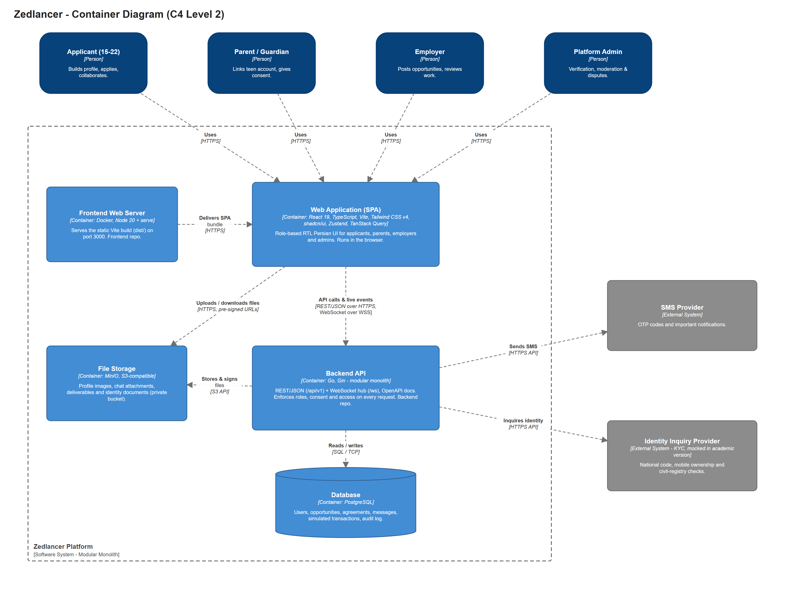

# Zedlancer — Architecture Documentation (Frontend Repository)

Zedlancer is a platform that manages work opportunities, earning and skill growth for teens and young adults (15–22).
The architecture documentation is split between the **Frontend** and **Backend** repositories:

| Folder | Content | In which repo? |
|---|---|---|
| [`shared/`](shared/system-architecture.md) | Architecture style (Modular Monolith), building blocks, technology overview, **frontend–backend contract** (API, auth, WebSocket, files), deployment, Context / Container / Deployment diagrams, decision log | **Both repos, identical copies** |
| [`structurizr/`](structurizr/workspace.dsl) | C4 model in Structurizr DSL (shared model + frontend component view) | Both repos (the backend adds its own component view) |
| [`frontend/`](frontend/frontend-architecture.md) | Frontend architecture: project structure, layers, state management, routing, forms, real-time, technologies, conventions, Component diagram | **Frontend repo only** |
| `backend/` | Backend architecture and backend Component diagram | Backend repo only |

## Quick links

- **System architecture (shared):** [shared/system-architecture.md](shared/system-architecture.md)
- **Frontend architecture:** [frontend/frontend-architecture.md](frontend/frontend-architecture.md)

## Architecture at a glance

- **Style:** Modular Monolith. One React SPA and one Go (Gin) backend, both organised by business feature.
- **Frontend:** React 19 · TypeScript · Vite · Tailwind CSS v4 · shadcn/ui · Zustand · TanStack Query · Axios · Formik + Yup · React Router.
- **Backend:** Go · Gin · PostgreSQL · MinIO · WebSocket · OpenAPI.
- **Verification:** all roles upload documents at sign-up and an admin approves them before panel access; identity checks go through a KYC adapter (mocked in the academic version).
- **Delivery:** Docker · GitHub Actions · ghcr.io · SSH deploy through Cloudflare Tunnel · Telegram notifications.

## Diagrams (C4 model)

| Level | Diagram | PNG | Editable source |
|---|---|---|---|
| 1 | System Context | [png](shared/diagrams/01-system-context.png) | [drawio](shared/diagrams/01-system-context.drawio) |
| 2 | Container | [png](shared/diagrams/02-container.png) | [drawio](shared/diagrams/02-container.drawio) |
| 3 | Component — Frontend Workspace feature | [png](frontend/diagrams/03-component-workspace.png) | [drawio](frontend/diagrams/03-component-workspace.drawio) |
| — | Deployment | [png](shared/diagrams/04-deployment.png) | [drawio](shared/diagrams/04-deployment.drawio) |
| 1–3 | All views | — | [Structurizr DSL](structurizr/workspace.dsl) |



### Editing diagrams

- **Draw.io:** open a `.drawio` file in [app.diagrams.net](https://app.diagrams.net) or the VS Code *Draw.io Integration* extension. After editing, export it with **File → Export as → PNG** (zoom 200%) and overwrite the PNG next to it.
- **Structurizr:**

```bash
docker run -it --rm -p 8080:8080 -v "$(pwd)/docs/architecture/structurizr":/usr/local/structurizr structurizr/lite
# open http://localhost:8080
```
