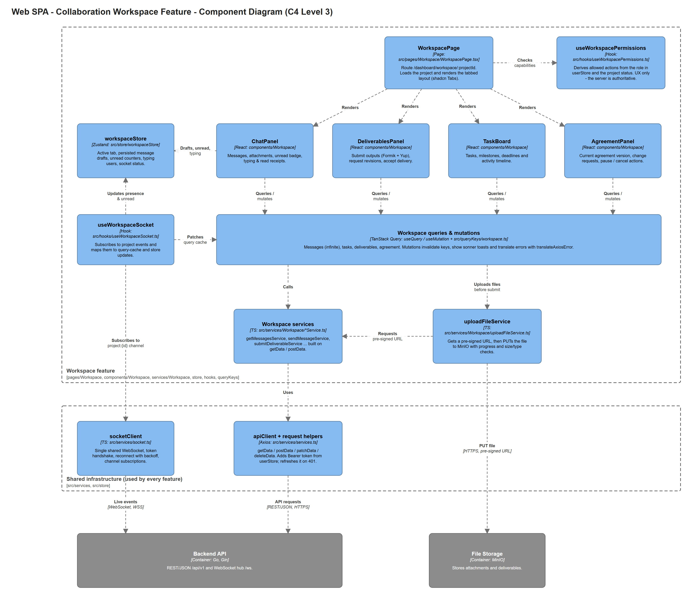

# Zedlancer — Frontend Architecture

> **Frontend repo only.** Owned by the frontend team.
> For the system-wide architecture, API contract and deployment, see [`../shared/system-architecture.md`](../shared/system-architecture.md).
>
> The structure and conventions follow the team's previous frontend project, [Hona-Tahlil/Frontend](https://github.com/Hona-Tahlil/Frontend). We kept what worked there and added what Zedlancer needs: route guards, a token refresh flow, WebSocket support and environment-based config.

## Table of Contents

1. [Architecture Style](#1-architecture-style)
2. [Project Structure](#2-project-structure)
3. [Features and Their Files](#3-features-and-their-files)
4. [Layer Responsibilities and Dependency Rules](#4-layer-responsibilities-and-dependency-rules)
5. [State Management and Data Flow](#5-state-management-and-data-flow)
6. [Routing, Layouts and Guards](#6-routing-layouts-and-guards)
7. [Forms and Validation](#7-forms-and-validation)
8. [Real-time (WebSocket)](#8-real-time-websocket)
9. [Cross-Cutting Concerns](#9-cross-cutting-concerns)
10. [Technology Stack and Rationale](#10-technology-stack-and-rationale)
11. [Coding Conventions](#11-coding-conventions)
12. [Build, Run and Deploy](#12-build-run-and-deploy)
13. [Component Diagram — Collaboration Workspace](#13-component-diagram--collaboration-workspace)
14. [Improvements over the Hona Setup](#14-improvements-over-the-hona-setup)

---

## 1. Architecture Style

The frontend is a **single-page application (SPA)** built with React and TypeScript. It is the frontend part of the system's **Modular Monolith** (see the shared document): one codebase, one build, one deployment.

The code is organised in **two dimensions**:

1. **By layer.** Each technical concern has its own top-level folder: `pages/`, `components/`, `services/`, `store/`, `types/`, `schemas/`, `queryKeys/`, …
2. **By feature, inside each layer.** Every business capability has a subfolder with the **same name** in every layer, e.g. `components/Workspace/`, `services/Workspace/`, `types/Workspace/`.

```
              Auth   Opportunity   Application   Agreement   Workspace   …
pages/         ●          ●             ●            ●           ●
components/    ●          ●             ●            ●           ●
services/      ●          ●             ●            ●           ●
types/         ●          ●             ●            ●           ●
schemas/       ●          ●             ●            ●           ●
queryKeys/     ●          ●             ●            ●           ●
```

**Why this style:**

- The team already used it successfully in the Hona project, so we start productive.
- It matches the shadcn/ui and Vite conventions (`@/components/ui`, `@/lib/utils`, `@/hooks`).
- Finding code is predictable: "the API call for X" is always in `services/X/`, "the types for X" are always in `types/X/`.
- Feature names are the same as the backend modules and API paths (shared document §2), so a capability can be traced from UI to database.
- Micro-frontends were rejected: four developers on one product do not need independent deployments.

## 2. Project Structure

```
Frontend/
├── .github/workflows/CD.yml       # Build → ghcr.io → deploy (see shared §7)
├── Dockerfile                     # node:20-alpine build + `serve -s dist` on :3000
├── docker-compose.yml             # frontend service on the external `web` network
├── components.json                # shadcn/ui config (style: new-york, icons: lucide)
├── vite.config.ts                 # React + Tailwind plugins, alias "@" → src, port 3000
├── .env.example                   # VITE_API_BASE_URL, VITE_WS_URL
└── src/
    ├── assets/                    # Images, icons and Persian font files (woff2/woff/ttf)
    ├── components/
    │   ├── ui/                    # shadcn/ui primitives (button, dialog, tabs, select, skeleton, sonner …)
    │   ├── Custom/                # Project-wide custom components built on ui/
    │   │                          #   Input, Button, DatePicker (Jalali), Dialog, Select, Avatar,
    │   │                          #   Rating, Tabs, Toast, EmptyState, ErrorState …
    │   ├── Navbar/  Footer/  Sidebar/
    │   └── <Feature>/             # Feature components: Auth/, Opportunity/, Workspace/ …
    ├── data/                      # Static constants (sidebar items per role, categories, FAQ)
    ├── hooks/                     # Custom hooks (ResponsiveHooks, useWorkspaceSocket, permissions …)
    ├── layouts/                   # PublicLayout, AuthLayout, DashboardLayout, AdminLayout, MobileLayout
    ├── lib/                       # utils.ts (cn helper for shadcn)
    ├── pages/                     # Route-level pages, one folder per feature / role
    ├── providers/                 # GlobalProviders (QueryClient, Tooltip, Toaster)
    ├── queryKeys/                 # TanStack Query keys per feature
    ├── routes/                    # routes.tsx (createBrowserRouter) + guards/
    ├── schemas/                   # Formik initialValues + Yup validationSchema per form
    ├── services/
    │   ├── services.ts            # apiClient (Axios) + getData/postData/patchData/putData/deleteData
    │   ├── socket.ts              # socketClient (single WebSocket connection)
    │   └── <Feature>/             # Feature service functions: xxxService.ts
    ├── store/                     # Zustand stores (userStore, workspaceStore, draftStore …)
    ├── types/                     # TypeScript types; apiTypes.ts + <Feature>/ folders
    ├── utils/                     # errorTranslator, Jalali/Tehran date helpers, number formatting
    ├── index.css                  # Tailwind entry, @font-face, theme variables, RTL helpers
    └── main.tsx                   # createRoot → providers → RouterProvider
```

## 3. Features and Their Files

| Feature | FS | Pages (`pages/`) | Main components (`components/<Feature>/`) |
|---|---|---|---|
| **Auth** | 6.3 | Login, Signup (role + birth date), VerifyOtp, ForgetPassword, ChangePassword | LoginForm, SignupForm, OtpForm, AuthBackground |
| **Verification** | 6.3, 6.4, 9.3 | Signup document step, VerificationStatus (tracking code), Admin/Verifications | DocumentUploader, DocumentStatusList, TrackingCodeForm, VerificationReviewPanel |
| **Family** | 6.4, 6.11 | ParentDashboard, LinkTeen, ConsentRequests | LinkRequestCard, ConsentCard, TeenActivityList |
| **Profile** | 6.5 | Profile, EditProfile, SkillPassport | ProfileHeader, SkillList, PassportEntryCard |
| **Opportunity** | 6.6, 6.8, 6.9 | ExploreOpportunities, OpportunityDetail, CreateOpportunity (multi-step), MyOpportunities | FiltersBox, MobileFilterDrawer, OpportunityCard, OpportunityMultiStage |
| **Application** | 6.10 | MyApplications, OpportunityApplicants | ApplyDialog, ApplicantCard, OfferCard |
| **Agreement** | 6.12, 6.18 | AgreementDetail | AgreementViewer, VersionHistory, ChangeRequestDialog |
| **Workspace** | 6.13–6.17 | WorkspacePage | ChatPanel, TaskBoard, DeliverablesPanel, AgreementPanel |
| **Review** | 6.21 | (dialog inside Workspace / Dashboard) | RatingDialog, ReviewList |
| **Safety** | 6.19, 6.20 | DisputeDetail | ReportDialog, DisputeTimeline |
| **Finance** | 6.25 | Wallet | WalletSummary, TransactionList (labelled *simulated*) |
| **Notification** | 6.22 | Notifications | NotificationBell, NotificationList, ActionItemList |
| **Dashboard** | 6.23 | ApplicantDashboard, EmployerDashboard | DashboardSidebar, StatCard, UpcomingDeadlines |
| **Admin** | 6.7, 6.24 | Admin/Moderation, Admin/Users, Admin/Reports, Admin/Disputes, Admin/Categories | AdminSidebar, AdminContainer, ModerationTable |

Each feature also has `services/<Feature>/`, `types/<Feature>/`, a query-key file in `queryKeys/` and, if it has forms, schema files in `schemas/`.

## 4. Layer Responsibilities and Dependency Rules

| Layer | Responsibility | May use |
|---|---|---|
| `pages/` | One component per route. Reads route params, composes feature components, chooses the layout. | components, hooks, store, services, queryKeys, types |
| `components/<Feature>/` | Feature UI. Runs `useQuery` / `useMutation`, renders loading / empty / error states. | components/ui, components/Custom, hooks, store, services, queryKeys, schemas, types, utils |
| `components/Custom/`, `components/ui/` | Generic, reusable UI with **no business logic** and no API calls. | lib, utils, types |
| `services/<Feature>/` | One function per endpoint, typed request/response. **No React code.** | `services/services.ts`, types |
| `services/services.ts` | The only place that creates the Axios instance (base URL, token, refresh, errors). | store (userStore), types |
| `store/` | Global client state (Zustand). **No server data copies.** | types |
| `queryKeys/` | Query-key constants / factories. | — |
| `schemas/` | Formik `initialValues` + Yup `validationSchema` with Persian messages. | — |
| `types/` | TypeScript types and interfaces. | — |
| `utils/`, `lib/` | Pure helper functions. | — |

**Rules:**

1. Components never call `axios` directly. They always go through a service function.
2. Server data lives in the TanStack Query cache, never in Zustand.
3. `ui/` and `Custom/` components never import from `services/` or `store/`.
4. Always import with the `@/` alias (`@/services/Workspace/getMessagesService`), never with long relative paths.
5. A feature may reuse another feature's **components and types**. Shared logic moves to `hooks/`, `utils/` or `components/Custom/`.

## 5. State Management and Data Flow

### 5.1 Where each kind of state lives

| Kind of state | Tool | Examples |
|---|---|---|
| **Server state** | **TanStack Query** | Opportunities, applications, messages, agreements, notifications |
| **Session / user** | **Zustand** `userStore` (persisted in `sessionStorage`) | id, name, role, consent status. **The access token is kept in memory only** (excluded with `partialize`). |
| **Feature UI state** | **Zustand** feature stores | `workspaceStore`: active tab, unread counters, typing users, socket status |
| **Form drafts** | **Zustand** `draftStore` (persisted in `localStorage`) | Unfinished opportunity post, application, agreement change (FS 6.27) |
| **Form state** | **Formik** | All forms |
| **URL state** | React Router search params | Search filters, page number, selected tab |

### 5.2 Request flow (based on the Hona service pattern)

```ts
// src/services/Workspace/getMessagesService.ts
export const getMessagesService = (projectId: number, page: number) =>
  getData({ endPoint: `/projects/${projectId}/messages`, params: { page, pageSize: 30 } });

// src/queryKeys/workspace.ts
export const WORKSPACE_KEYS = {
  all: ["workspace"] as const,
  messages: (projectId: number) => ["workspace", projectId, "messages"] as const,
  deliverables: (projectId: number) => ["workspace", projectId, "deliverables"] as const,
};

// src/components/Workspace/ChatPanel.tsx
const { data, isLoading, error } = useInfiniteQuery({
  queryKey: WORKSPACE_KEYS.messages(projectId),
  queryFn: ({ pageParam = 1 }) => getMessagesService(projectId, pageParam),
  getNextPageParam: (last) => (last.page * last.pageSize < last.total ? last.page + 1 : undefined),
});
```

```
Component ──useQuery/useMutation──▶ services/<Feature>/xxxService.ts
                                       └─▶ services.ts (getData/postData)
                                             └─▶ apiClient (Axios)
                                                   ├─ request:  Authorization: Bearer <token from userStore>
                                                   └─ response: 401 → POST /auth/refresh (cookie) → retry once
                                                                 error → translateAxiosError() → sonner toast
```

### 5.3 Mutations

- `useMutation` → service function. An `Idempotency-Key` (`crypto.randomUUID()`) is created **once per user action** and reused on retry.
- `onSuccess`: `queryClient.invalidateQueries({ queryKey: … })` + success toast.
- `onError`: `translateAxiosError(error)` → Persian error toast. Field errors from the API are mapped to Formik with `setErrors`.
- The submit button is disabled while `isPending`, so double-clicks cannot create duplicates (FS 6.27).

## 6. Routing, Layouts and Guards

- **Router:** `createBrowserRouter` in `src/routes/routes.tsx` (React Router v7), as in Hona.
- **Lazy loading:** feature pages are loaded with `React.lazy`, so each role downloads only what it uses.
- **Layouts** (all set `dir="rtl"` and the Persian font):

| Layout | Used for |
|---|---|
| `PublicLayout` | Landing, explore opportunities, about, terms (Navbar + Footer) |
| `AuthLayout` | Login, signup, OTP, password reset |
| `DashboardLayout` | Applicant, parent and employer areas (role-based sidebar from `data/`) |
| `AdminLayout` | Admin panel (AdminSidebar) |
| `MobileLayout` | Full-screen mobile flows (e.g. multi-step forms) |

- **Guards** (`src/routes/guards/`): `RequireAuth`, `RequireVerified` (redirects to the verification status page until the admin has approved all documents), `RequireRole(["employer"])` and `RequireConsent` (for 15–17 year-olds without approved consent). They improve the experience but are **not security**: the backend checks every request (shared §6.2).

```
/                       PublicLayout
/login, /signup …       AuthLayout
/verification/status    AuthLayout (tracking code + OTP, re-upload rejected documents)
/dashboard/*            RequireAuth → RequireVerified → DashboardLayout → role-specific pages
/dashboard/workspace/:projectId   RequireAuth → RequireConsent → WorkspacePage
/admin/*                RequireAuth → RequireRole(admin) → AdminLayout
*                       Error404
```

## 7. Forms and Validation

Following the Hona convention, each form has a schema file that exports `initialValues` and `validationSchema`:

```ts
// src/schemas/Opportunity/CreateOpportunitySchema.ts
const validationSchema = Yup.object({
  title: Yup.string().min(5, "عنوان باید حداقل ۵ کاراکتر باشد").required("عنوان اجباری است"),
  budget: Yup.number().min(0).required("مبلغ اجباری است"),
  deadline: Yup.date().min(new Date(), "مهلت باید در آینده باشد").required(),
});
const initialValues = { title: "", budget: 0, deadline: null, categoryId: null };
export default { initialValues, validationSchema };
```

- Formik inputs are wrapped in `components/Custom/Input`, `Select`, `DatePicker` and `Textarea`, so error display and RTL direction are consistent.
- Long forms are multi-step (`MultiStage` component, as in Hona) and save drafts to `draftStore`.
- Client validation is for user experience. The backend validates again and its errors are shown on the matching fields.

## 8. Real-time (WebSocket)

Based on the shared contract (shared §6.3):

- `services/socket.ts` → **`socketClient`**: one WebSocket connection per tab, opened after login. It sends the auth message, reconnects with exponential backoff, re-authenticates after a token refresh, and lets callers subscribe/unsubscribe to channels.
- **Feature hooks** subscribe to channels and update state:
  - `useNotificationSocket` (in DashboardLayout) → channel `user:{id}` → updates notification queries and the bell badge.
  - `useWorkspaceSocket(projectId)` (in WorkspacePage) → channel `project:{id}` → appends messages to the query cache, updates `workspaceStore` (typing, unread), and invalidates deliverable/agreement queries.
- Sending is always done over REST (`sendMessageService`). The socket only **receives**.
- After a reconnect, affected queries are invalidated so nothing is missed. The connection state is shown in the UI ("connecting…").

## 9. Cross-Cutting Concerns

| Concern | Approach | FS |
|---|---|---|
| **RTL & Persian** | `dir="rtl"` on every layout. Persian font loaded with `@font-face` in `index.css`. Tailwind logical utilities (`ms-*`, `pe-*`). `utils/adjustInputDirection` for mixed LTR input (email, numbers). | 6.27 |
| **Jalali dates** | `react-multi-date-picker` + `react-date-object` (Persian calendar) for pickers. `jalaali-js` for conversion. `utils/toTehranISOString` turns user input into UTC ISO strings for the API. | 6.27 |
| **Numbers** | `utils/translateNumber` (Persian digits), `utils/formatNumber` (thousands separator for Rial amounts). | 6.27 |
| **Responsive** | Mobile-first Tailwind breakpoints, `hooks/ResponsiveHooks` (`react-responsive`) for layout switches, `vaul` drawers on mobile (e.g. filters). | 6.27 |
| **UI states** | Every data view shows loading (`Skeleton`), empty (`EmptyState`), error (`ErrorState` + retry), offline and no-permission states. | 6.27 |
| **Errors & feedback** | `utils/errorTranslator.translateAxiosError` → Persian messages. `sonner` toasts. An error boundary per layout. | 6.27 |
| **Identity & documents** | Sign-up includes a document upload step (via pre-signed URLs). Users check status and fix rejected documents with their tracking code. Format validators (national code, company national ID, mobile, postal code) live in `utils/validators` and are used by Yup schemas; the backend validates again. The frontend never calls the identity provider and never stores documents or national codes in browser storage. | 6.3, 5.7, 9.3 |
| **Access control (UX)** | Guards + `useXxxPermissions` hooks hide actions the user cannot take. The server stays authoritative and the UI handles `403`. | 5.6 |
| **Privacy** | No personal data (phone, address, ID documents) in `localStorage` or URLs. Access token in memory only. | 5.7 |
| **Simulated finance** | Finance screens always show a *Test / Simulated* badge. Amounts come from the server. | 6.25 |
| **Accessibility** | Radix-based shadcn components (keyboard and focus support), labelled inputs, sufficient contrast. | 6.27 |
| **Animation** | `framer-motion` for small transitions only. | — |

## 10. Technology Stack and Rationale

| Technology | Version (target) | Role | Why |
|---|---|---|---|
| **React** | 19 | UI library | Component model for a UI with many roles. The team knows it (FS §7.1). |
| **TypeScript** | 5.x | Language | Typed API contracts, fewer runtime errors (FS §7.1). |
| **Vite** | 7 | Build & dev server | Very fast HMR, simple static output, official Tailwind plugin. |
| **Tailwind CSS** | 4 (`@tailwindcss/vite`) | Styling | Utility-first, consistent design tokens, RTL-friendly, no CSS conflicts between features. |
| **shadcn/ui** (Radix UI) | new-york style | UI primitives | Accessible, unstyled-by-default components copied into the repo (`components/ui`), so we can fully customise them. |
| **lucide-react**, react-icons | — | Icons | The shadcn default icon set. |
| **Zustand** | 5 | Client state | Tiny API, no boilerplate, `persist` middleware for session and drafts. |
| **TanStack Query** | 5 (Hona used 4; same concepts) | Server state | Caching, background refetch, pagination/infinite queries, invalidation, mutation states. |
| **Axios** | 1.x | HTTP client | Interceptors for token, refresh and errors in one place (`services.ts`). |
| **React Router** | 7 | Routing | Nested layouts, lazy routes, URL search params. |
| **Formik + Yup** | 2 / 1 | Forms & validation | Same as Hona. Schema files with Persian messages, easy multi-step forms. |
| **react-multi-date-picker**, jalaali-js | — | Jalali dates | Persian calendar picker and conversion. |
| **sonner** | 2 | Toasts | Simple, styled notifications (shadcn integration). |
| **framer-motion** | 12 | Animation | Small UI transitions. |
| **vaul**, embla-carousel | — | Drawer, carousel | Mobile drawers and landing carousels (shadcn integrations). |
| **ESLint** (typescript-eslint, react-hooks) | 9 | Linting | Consistent code, hook rules. |
| **Docker + serve** | Node 20 | Runtime | Static hosting of `dist/` with SPA fallback (`serve -s`). |

## 11. Coding Conventions

| Item | Convention | Example |
|---|---|---|
| Component files & folders | PascalCase, one component per file | `components/Workspace/ChatPanel.tsx` |
| Pages | PascalCase, in a feature folder | `pages/Workspace/WorkspacePage.tsx` |
| Service functions | `<verb><Entity>Service`, one endpoint per function | `submitDeliverableService` |
| Types | Feature folder, `XxxPayload` / `XxxResponse` | `types/Workspace/messageTypes.ts` |
| Schemas | `<FormName>Schema.ts` exporting `{ initialValues, validationSchema }` | `schemas/Auth/LoginSchema.ts` |
| Query keys | `<FEATURE>_KEYS` object with factory functions | `WORKSPACE_KEYS.messages(id)` |
| Stores | `<name>Store.ts`, default export `use<Name>Store` | `store/userStore/userStore.ts` |
| Imports | Always the `@/` alias | `import { getData } from "@/services/services"` |
| Git | Branches `feat/…`, `fix/…`. PRs into `develop` (triggers CD). | `feat/workspace-chat` |

## 12. Build, Run and Deploy

```bash
npm install
npm run dev        # http://localhost:3000
npm run build      # tsc -b && vite build → dist/
npm run lint
```

Environment variables (`.env`, see `.env.example`):

```
VITE_API_BASE_URL=https://api.<domain>/api/v1
VITE_WS_URL=wss://api.<domain>/ws
```

Deployment uses the shared pipeline (shared §7): on push to `develop`, GitHub Actions builds the Docker image, pushes `ghcr.io/<org>/frontend`, deploys it to the server over SSH, and reports to Telegram.

## 13. Component Diagram — Collaboration Workspace

We chose the **Workspace** feature for the component diagram because it is the most complex part of the frontend. It combines REST and WebSocket data, file uploads, four stateful panels, permission-dependent actions and idempotent mutations.



Source: [`diagrams/03-component-workspace.drawio`](diagrams/03-component-workspace.drawio) · Also in Structurizr: view `WorkspaceComponents` in [`../structurizr/workspace.dsl`](../structurizr/workspace.dsl)

| Component | Location | Responsibility |
|---|---|---|
| `WorkspacePage` | `pages/Workspace/WorkspacePage.tsx` | Route entry. Loads the project and renders the tabs. |
| `useWorkspacePermissions` | `hooks/` | Decides which actions to show, based on role and project status (UX only). |
| `ChatPanel`, `DeliverablesPanel`, `TaskBoard`, `AgreementPanel` | `components/Workspace/` | The four workspace tabs. |
| Workspace queries & mutations | `useQuery` / `useMutation` + `queryKeys/workspace.ts` | Reading and writing workspace data, cache invalidation, toasts. |
| `workspaceStore` | `store/` | UI-only state: active tab, drafts, unread counters, typing users. |
| `useWorkspaceSocket` | `hooks/` | Turns socket events into cache and store updates. |
| Workspace services | `services/Workspace/*Service.ts` | One typed function per endpoint. |
| `uploadFileService` | `services/Workspace/` | Pre-signed URL upload to MinIO. |
| `socketClient` | `services/socket.ts` | Shared WebSocket connection. |
| `apiClient` + helpers | `services/services.ts` | Shared Axios instance: token, refresh, errors. |

## 14. Improvements over the Hona Setup

| Hona | Zedlancer | Reason |
|---|---|---|
| `baseURL` hard-coded in `services.ts` | `import.meta.env.VITE_API_BASE_URL` | Different environments without code changes |
| Access token persisted in `sessionStorage` | Access token in memory + refresh cookie | Less exposure to XSS (shared §6.2) |
| No route guards (`PrivateLayout` commented out) | `RequireAuth`, `RequireRole`, `RequireConsent` | Four roles and age-based consent |
| Query keys as plain constants | Key factories per feature | Fine-grained invalidation (per project, per page) |
| `"build": "tsc -b \|\| true && vite build \|\| true"` | `"build": "tsc -b && vite build"` | Type errors must fail the build, so CD stops broken deploys |
| No real-time | `socketClient` + feature socket hooks | Chat and notifications (FS 6.15, 6.22) |
| All routes imported eagerly | `React.lazy` per feature page | Smaller initial bundle |
