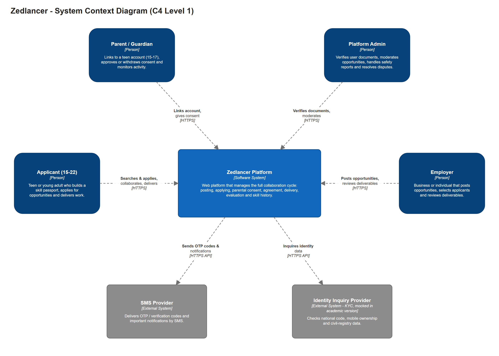
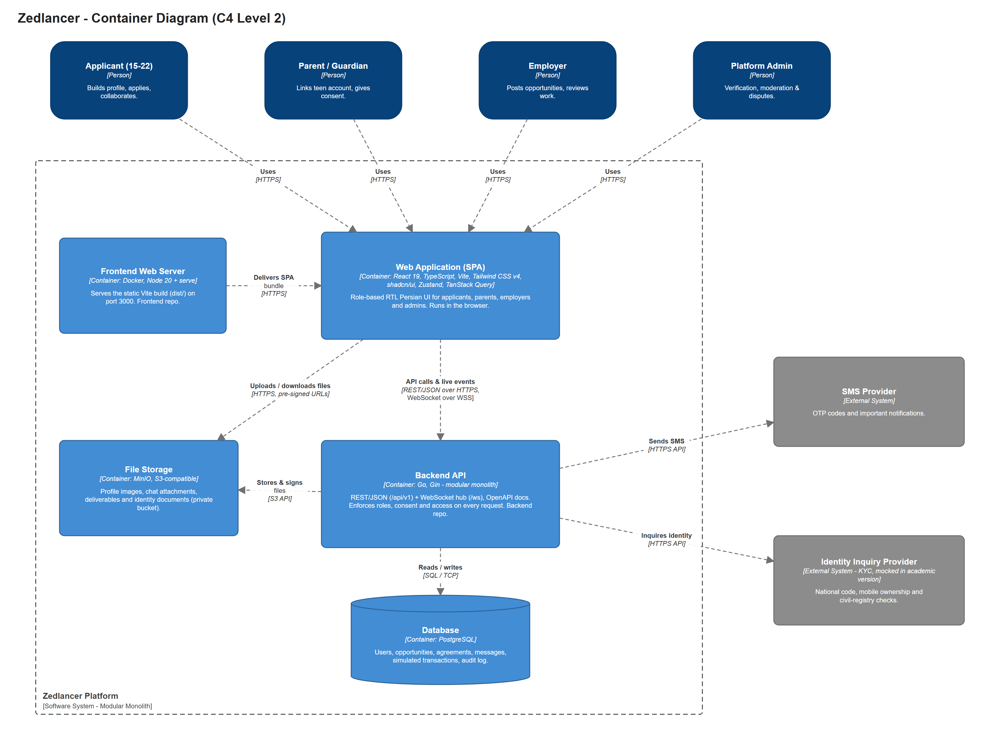
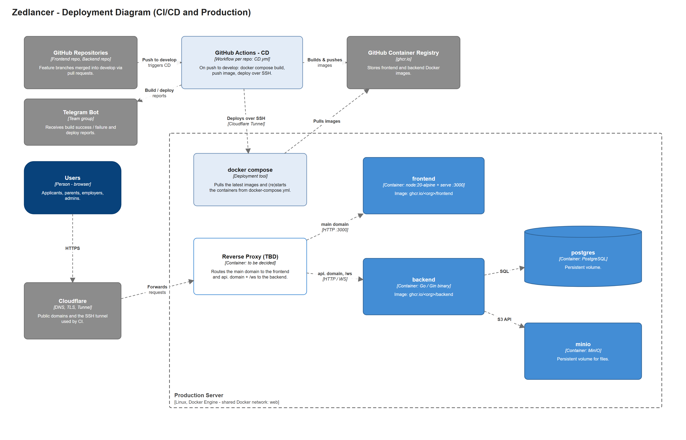

# Zedlancer — System Architecture (Shared)

> **Shared document.** This file and the `shared/` folder must be kept **identical** in the Frontend and Backend repositories.
> Change it with a pull request in one repo and copy the same change to the other.
>
> | Part | Owner |
> |---|---|
> | Shared architecture (this file, `shared/diagrams/`, `structurizr/`) | Frontend + Backend leads, together |
> | Frontend architecture (`frontend/`) | Frontend team, Frontend repo only |
> | Backend architecture (`backend/`) | Backend team, Backend repo only |
>
> Source of requirements: *Zedlancer Feasibility Study (FS)*.

## Table of Contents

1. [System Overview](#1-system-overview)
2. [Architecture Style](#2-architecture-style)
3. [Main Building Blocks](#3-main-building-blocks)
4. [Relationships Between Building Blocks](#4-relationships-between-building-blocks)
5. [Technology Overview and Rationale](#5-technology-overview-and-rationale)
6. [Frontend–Backend Integration Contract](#6-frontendbackend-integration-contract)
7. [Deployment and Environments](#7-deployment-and-environments)
8. [Architecture Diagrams](#8-architecture-diagrams)
9. [Decision Log](#9-decision-log)
10. [Open Questions](#10-open-questions)

---

## 1. System Overview

Zedlancer is a web platform that connects **teens and young adults (15–22)** with **employers** who need small, well-defined online or in-person tasks. It does more than list jobs: it manages the whole collaboration cycle.

```
Sign up & upload documents → Admin verification → Post opportunity → Moderation
→ Search & apply → Select applicant → Parental consent (15–17)
→ Versioned agreement → Collaboration workspace → Delivery & review → Simulated payment
→ Rating → Skill passport entry
```

| Actor | Description |
|---|---|
| **Applicant (15–22)** | Builds a profile and skill passport, applies for opportunities, collaborates and delivers work. Users aged 15–17 need parental consent. |
| **Parent / Guardian** | Links to a teen account, gives or withdraws consent, monitors activity. |
| **Employer** | Posts opportunities, selects applicants, manages agreements, reviews deliverables. |
| **Platform Admin** | Verifies user documents, moderates opportunities, handles safety reports, resolves disputes. |
| **SMS Provider** *(external)* | Sends OTP / verification codes and important notifications. |
| **Identity Inquiry Provider** *(external, mocked in the academic version)* | KYC service for national code, mobile ownership and civil-registry checks. |

## 2. Architecture Style

**Zedlancer is a Modular Monolith** (FS, executive summary).

| Option | Decision | Reason |
|---|---|---|
| Monolith (unstructured) | ❌ Rejected | About 28 capabilities would become tightly coupled and hard to develop in parallel |
| Microservices | ❌ Rejected | Too much operational cost (many deployments, network calls, distributed data) for a 6-person team and an MVP |
| **Modular Monolith** | ✅ **Chosen** | One backend deployment and one database keep operations simple. Clear module boundaries keep the code organised, and a module can be extracted later if it ever needs to scale on its own |

**How the style applies to each side:**

- **Backend:** one Go (Gin) application split into business modules (auth, opportunities, agreements, workspace, …). Modules communicate through interfaces, not by reading each other's tables. *Details: Backend repo.*
- **Frontend:** one React SPA organised by layers (`pages`, `components`, `services`, `store`, …), with a **feature subfolder per business capability** inside each layer. *Details: `frontend/frontend-architecture.md`.*
- **Same feature names on both sides.** A feature has the same name in the frontend folders, the backend module and the API path. This makes it easy to follow one capability end to end:

| Feature | FS capabilities | Frontend folder name | API prefix |
|---|---|---|---|
| Auth | 6.3 | `Auth` | `/api/v1/auth` |
| Verification (documents & identity) | 6.3, 6.4, 9.3 | `Verification` | `/api/v1/verification` |
| Family (parent link & consent) | 6.4, 6.11 | `Family` | `/api/v1/family` |
| Profile & skill passport | 6.5 (+6.5.1, 6.5.2 optional) | `Profile` | `/api/v1/profiles` |
| Opportunities | 6.6, 6.7, 6.8, 6.9 | `Opportunity` | `/api/v1/opportunities` |
| Applications | 6.10 | `Application` | `/api/v1/applications` |
| Agreements | 6.12, 6.18 | `Agreement` | `/api/v1/agreements` |
| Workspace (tasks, chat, delivery) | 6.13–6.17 | `Workspace` | `/api/v1/projects` |
| Reviews | 6.21 | `Review` | `/api/v1/reviews` |
| Safety & disputes | 6.19, 6.20 | `Safety` | `/api/v1/reports`, `/api/v1/disputes` |
| Finance (simulated) | 6.25 | `Finance` | `/api/v1/wallet` |
| Notifications | 6.22 | `Notification` | `/api/v1/notifications` |
| Dashboards | 6.23 | `Dashboard` | (aggregates other endpoints) |
| Admin | 6.7, 6.24 | `Admin` | `/api/v1/admin` |
| Files | — | `File` (shared service) | `/api/v1/files` |

## 3. Main Building Blocks

| Building block (C4 container) | Technology | Repo | Responsibility |
|---|---|---|---|
| **Web Application (SPA)** | React 19, TypeScript, Vite, Tailwind CSS v4, shadcn/ui, Zustand, TanStack Query | Frontend | Role-based RTL Persian UI, running in the browser |
| **Frontend Web Server** | Docker (Node 20 + `serve`) | Frontend | Serves the static build (`dist/`) on port 3000 |
| **Backend API** | Go, Gin (modular monolith) | Backend | Business rules, REST/JSON API, WebSocket hub, **authoritative access control** |
| **Database** | PostgreSQL | Backend | Persistent relational data (users, agreements, messages, simulated transactions, audit log) |
| **File Storage** | MinIO (S3-compatible) | Backend (infra) | Profile images, chat attachments, deliverables, identity documents (separate private bucket) |
| **Reverse Proxy** | *To be decided* | Infra | Routes domains to the frontend and backend containers |
| **SMS Provider** | External service | — | OTP and notification SMS (called by the backend only) |
| **Identity Inquiry Provider** | External KYC service (mock adapter in the academic version) | — | Identity checks (called by the backend only) |

## 4. Relationships Between Building Blocks

| From → To | Protocol | Purpose |
|---|---|---|
| User's browser → Frontend Web Server | HTTPS | Load the SPA (HTML, JS, CSS, fonts) |
| SPA → Backend API | REST/JSON over HTTPS | All queries and commands |
| SPA ↔ Backend API | WebSocket over WSS | Chat, typing/read receipts, live notifications, status changes |
| SPA → File Storage | HTTPS, **pre-signed URL** | Upload/download files directly. The backend only issues the signed URL |
| Backend API → Database | SQL / TCP | Read and write data |
| Backend API → File Storage | S3 API | Create pre-signed URLs, check uploads, manage objects |
| Backend API → SMS Provider | HTTPS API | Send OTP and notification SMS |
| Backend API → Identity Inquiry Provider | HTTPS API | Identity checks during verification |

**Key rule:** the frontend never talks to the database, the SMS provider or the identity provider. The only things it can reach are the Backend API and pre-signed file URLs.

## 5. Technology Overview and Rationale

### 5.1 Frontend (summary; full rationale in `frontend/frontend-architecture.md`)

| Technology | Why |
|---|---|
| React 19 + TypeScript | Component model suits a UI with many roles. TypeScript catches errors in data contracts (FS §7.1). |
| Vite | Fast dev server and build. Static output is easy to serve from Docker. |
| Tailwind CSS v4 + shadcn/ui (Radix) | Fast, consistent styling, RTL-friendly. Accessible ready-made primitives. |
| Zustand | Minimal global client state (session, UI state, drafts). |
| TanStack Query | Server-state caching, refetching, pagination and invalidation. |
| Axios | One HTTP client with interceptors for auth token and errors. |
| Formik + Yup | Form state and validation with Persian error messages. |

### 5.2 Backend (summary; full rationale in the Backend repo)

| Technology | Why |
|---|---|
| **Go** | Performance, built-in concurrency (good for the WebSocket hub), simple language, strong web tooling (FS §7.2). |
| **Gin** | Lightweight, widely used HTTP framework with middleware for auth, CORS, logging and validation. |
| **PostgreSQL** | Strong consistency and transactions, needed for agreements, versions and simulated financial records. |
| **MinIO** | Self-hosted, S3-compatible storage. Pre-signed URLs keep large files off the API server. |
| **WebSocket** | Real-time chat and notifications (FS 6.15, 6.22). |
| **OpenAPI / Swagger** | Machine-readable API contract shared with the frontend. |

### 5.3 Infrastructure

| Technology | Why |
|---|---|
| **Docker + docker compose** | Same runtime in development and production. Each part is a container. |
| **GitHub Actions** | CD pipeline per repository, triggered on `develop` (same approach as the team's previous project, *Hona*). |
| **GitHub Container Registry (ghcr.io)** | Stores the built images next to the code. |
| **Cloudflare** | DNS, TLS and the tunnel used by CI to reach the server over SSH. |
| **Telegram bot** | Build and deploy notifications for the team. |

## 6. Frontend–Backend Integration Contract

Items marked **Agreed** are decided. Items marked **Proposed** are the default unless the backend team objects. See [§9](#9-decision-log).

### 6.1 API conventions

| Topic | Convention | Status |
|---|---|---|
| Base URL | `https://api.<domain>/api/v1` (frontend reads it from `VITE_API_BASE_URL`) | Agreed |
| Documentation | OpenAPI 3, generated by the backend and published at `/swagger`. The source of truth for request/response shapes. | Agreed |
| Format | JSON, `camelCase` field names | Proposed |
| Dates & times | ISO 8601 in UTC (e.g. `2026-11-02T08:30:00Z`). The frontend converts to Tehran time and the Jalali calendar for display. | Proposed |
| Money | Integer amounts in **Rial**. Amounts are always calculated on the server. | Proposed |
| Pagination | Request `?page=1&pageSize=20`. Response `{ "items": [...], "page": 1, "pageSize": 20, "total": 134 }` | Proposed |
| Errors | HTTP status + body `{ "code": "VALIDATION_ERROR", "message": "<Persian message>", "details": { "field": "reason" } }` | Proposed |
| Idempotency | State-changing requests that must not run twice (apply, accept offer, consent, deliver, simulated payment) accept an `Idempotency-Key` header (FS 6.25, 6.27) | Proposed |
| Versioning | Breaking changes go to `/api/v2`. Additive changes stay in `v1`. | Proposed |

### 6.2 Authentication and authorization — **Agreed**

- **Access token:** short-lived JWT (proposed: 15 min), sent as `Authorization: Bearer <token>`. It contains the user id and **role** (`applicant`, `parent`, `employer`, `admin`).
- **Refresh token:** long-lived, stored in an **`httpOnly`, `Secure`, `SameSite`** cookie. JavaScript cannot read it.
- **Endpoints:** `POST /auth/login`, `POST /auth/refresh`, `POST /auth/logout`, plus sign-up and OTP verification (OTP sent by SMS).
- **Refresh flow:** on `401`, the frontend calls `/auth/refresh` once (cookie sent with `withCredentials`), stores the new access token and retries the original request. If the refresh fails, the user is logged out.
- **CORS:** the backend allows only the frontend origin, with `Access-Control-Allow-Credentials: true`.
- **Authorization lives on the server.** Every request is checked against role, ownership, consent status and project state (FS 5.6). Hiding a button in the UI is never a security control.

### 6.3 Real-time (WebSocket) — **Agreed**

- **Endpoint:** `wss://api.<domain>/ws`. The client authenticates with the access token in its first message (proposed: `{ "type": "auth", "token": "..." }`) and re-authenticates after a token refresh.
- **Channels:** `user:{userId}` (notifications, action items) and `project:{projectId}` (chat, typing, delivery and status events). The server checks access before subscribing.
- **Event envelope (proposed):**

```json
{ "type": "message.created", "channel": "project:42", "data": { }, "sentAt": "2026-11-02T08:30:00Z" }
```

- **Event types (initial):** `message.created`, `message.read`, `typing.started`, `typing.stopped`, `deliverable.submitted`, `deliverable.reviewed`, `agreement.updated`, `project.status_changed`, `notification.created`.
- **Reliability:** WebSocket events are **notifications, not the source of truth**. After a reconnect the frontend refetches the affected data over REST. Sending a chat message happens over REST (`POST`), so it gets validation and idempotency. The server then broadcasts the event.

### 6.4 File upload — **Agreed** (PostgreSQL + MinIO)

```
1. SPA      → POST /api/v1/files/upload-url { fileName, contentType, size, purpose }
2. Backend  → checks permission, size and type → returns { fileId, uploadUrl (pre-signed PUT), expiresAt }
3. SPA      → PUT file directly to MinIO using uploadUrl
4. SPA      → sends fileId with the related request (e.g. submit deliverable, send message)
5. Backend  → links fileId to the entity. Downloads use short-lived pre-signed GET URLs.
```

Proposed limits (to confirm): max 20 MB per file; allowed types: images, PDF, Office documents, ZIP.

### 6.5 Error handling (shared expectations)

| Status | Meaning | Frontend behaviour |
|---|---|---|
| 400 / 422 | Validation error | Show field errors from `details`, otherwise `message` |
| 401 | Not authenticated / token expired | Try refresh once, then redirect to login |
| 403 | Not allowed (role, consent, ownership) | Show "no permission" state with the reason |
| 404 | Not found | Show not-found state |
| 409 | Conflict (e.g. state already changed, duplicate) | Refetch the data and show the message |
| 429 | Rate limited | Show "try again later" |
| 5xx | Server error | Show a generic error with a retry button |

### 6.6 Identity and document verification — **Agreed**

Every role that signs up (applicant, parent, employer) must be verified by an admin before using their panel (FS 6.3, 6.4; risk FS 9.3).

```
Sign up + upload documents ──▶ Admin review (per document: approve / reject with reason)
        │                                  │
        ▼                                  ▼
  Tracking code issued          All approved ──▶ account verified ──▶ access to own panel
                                Some rejected ──▶ user opens status page with tracking code
                                                  → sees rejected documents and reasons
                                                  → re-uploads only those ──▶ back to admin review
```

- **Statuses:** each document and the whole case use `pending → approved | rejected`. The case becomes `verified` only when all required documents are approved.
- **Tracking code:** issued at sign-up. It is checked together with the registered mobile number (OTP), so the code alone does not expose any documents.
- **Access rule:** until the case is `verified`, the backend allows only the verification endpoints. The panel and all other features are blocked on the server, not only hidden in the UI.
- **Identity inquiry:** the backend uses an `IdentityProvider` adapter with two implementations, `Mock` (academic version, test data as required by the FS) and `Real` (a licensed KYC provider later). It is selected by an environment variable.
- **Sensitive data:** documents are stored in a separate private MinIO bucket. Only admins get short-lived download URLs. National codes are stored encrypted, with a hash for uniqueness checks. Every document view and admin decision is written to the audit log (FS 5.7).
- **Endpoints (outline):** `POST /verification/documents`, `GET /verification/status` (tracking code + OTP), `PUT /verification/documents/{id}` (re-upload), and `GET/POST /admin/verification/...` for review. Exact shapes are defined in OpenAPI.
- **Out of scope here:** the exact list of documents per role, the admin review checklist and the business rules. These belong in the feature specification, not in the architecture.

## 7. Deployment and Environments

The pipeline follows the team's previous project (*Hona*), separately for each repository.

```
Pull request → merge to develop
   → GitHub Actions (CD.yml)
       1. docker compose build                (build fails if TypeScript / Go compilation fails)
       2. push image to ghcr.io/<org>/frontend | backend
       3. SSH to the server through Cloudflare Tunnel
       4. docker compose pull && docker compose up -d && docker image prune -f
       5. send build / deploy result to the team Telegram group
```

| Item | Frontend | Backend |
|---|---|---|
| Image | `ghcr.io/<org>/frontend` | `ghcr.io/<org>/backend` |
| Container | Node 20 Alpine + `serve -s dist`, port 3000 | Go binary (Gin) |
| Network | shared external Docker network `web` | `web` + internal network for PostgreSQL and MinIO |
| Config | `VITE_API_BASE_URL`, `VITE_WS_URL` (set at build time) | DB, MinIO, JWT secrets, SMS API key (environment variables / secrets) |

| Environment | Branch | Purpose |
|---|---|---|
| Local | any | `npm run dev` / `go run` with docker compose for PostgreSQL + MinIO |
| Production (course demo) | `develop` | Automatic deploy from the CD pipeline |

Secrets (`PAT`, `SERVER_HOST`, `SERVER_PRIVATE_KEY`, `TELEGRAM_*`, JWT and SMS keys) are stored only in GitHub Secrets and the server environment, never in the repositories.

## 8. Architecture Diagrams

All diagrams use the **C4 model**. They are drawn in **draw.io** (`.drawio`, editable) and exported to PNG. The same model is also written in **Structurizr DSL** (`../structurizr/workspace.dsl`).

### 8.1 System Context (C4 Level 1)



Source: [`diagrams/01-system-context.drawio`](diagrams/01-system-context.drawio)

### 8.2 Container (C4 Level 2)



Source: [`diagrams/02-container.drawio`](diagrams/02-container.drawio)

### 8.3 Deployment



Source: [`diagrams/04-deployment.drawio`](diagrams/04-deployment.drawio)

### 8.4 Component diagrams (per repository)

| Diagram | Location |
|---|---|
| Frontend — Collaboration Workspace feature | Frontend repo: `docs/architecture/frontend/diagrams/03-component-workspace.png` |
| Backend — module(s) chosen by the backend team | Backend repo: `docs/architecture/backend/diagrams/` |

## 9. Decision Log

| # | Decision | Status |
|---|---|---|
| D1 | Modular Monolith architecture | Agreed (FS) |
| D2 | React + TypeScript frontend, Go backend | Agreed (FS) |
| D3 | Gin as the Go HTTP framework | Agreed |
| D4 | PostgreSQL database, MinIO file storage with pre-signed URLs | Agreed |
| D5 | JWT access token (Bearer) + refresh token in an `httpOnly` cookie | Agreed |
| D6 | WebSocket for chat and notifications from the first version | Agreed |
| D7 | OpenAPI / Swagger as the API contract, path prefix `/api/v1` | Agreed |
| D8 | Docker + GitHub Actions + ghcr.io + SSH deploy (Hona pipeline) | Agreed |
| D9 | External systems: SMS provider and identity inquiry provider (KYC, mocked in the academic version). AI assistant, e-mail and push are out of the first version | Agreed |
| D10 | JSON camelCase, UTC ISO dates, Rial integers, pagination and error format of §6.1 | Proposed |
| D11 | Reverse proxy in front of the containers | Open |
| D12 | All roles upload documents at sign-up; admin approves or rejects each document; tracking code + OTP to see and fix rejected documents; panel access only after verification | Agreed |
| D13 | `IdentityProvider` adapter with Mock / Real implementations; documents in a private bucket; encrypted national codes; audit log | Agreed |

## 10. Open Questions

| # | Question | Owner |
|---|---|---|
| Q1 | Which reverse proxy (Nginx, Traefik, Caddy, or Cloudflare Tunnel directly to containers)? | Backend + Frontend |
| Q2 | Final domain names (main site and `api.` subdomain) | Team |
| Q3 | Confirm the proposed conventions in §6.1 (casing, dates, money, pagination, errors, idempotency) | Backend |
| Q4 | Which SMS provider, and is SMS used only for OTP or also for notifications? | Backend |
| Q5 | File size and type limits (§6.4) | Backend + Frontend |
| Q6 | Access / refresh token lifetimes | Backend |
| Q7 | Which licensed KYC provider for a production version? | Team |
